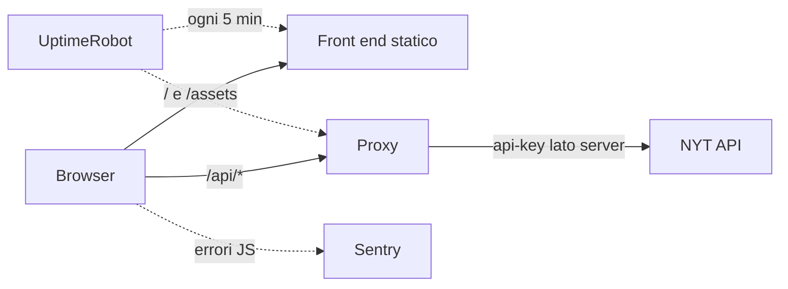
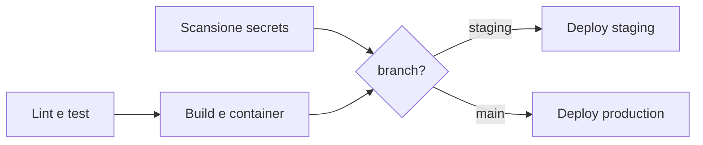

# New York Times clone · ciclo DevOps

[](https://github.com/GiuseppeB-portfolio/nyt-clone/actions/workflows/ci-cd.yml)

Clone della home del New York Times realizzato con React, che mostra le notizie della **Top Stories API** e permette di cercare articoli con la **Article Search API**. Questo repository è anche il progetto finale del modulo DevOps: contiene containerizzazione, pipeline CI/CD, gestione dei secrets e monitoraggio.

**Produzione:** https://nytclonee.netlify.app/  
**Staging:** https://staging--nytclonee.netlify.app/  
**Pipeline:** https://github.com/GiuseppeB-portfolio/nyt-clone/actions

---

## 1. Esplorazione

### Cosa fa l'app

È una Single Page App React (Vite, React Router, Axios, Tailwind CSS). La home mostra le top stories, ogni sezione (World, Business, Tech...) ha la sua pagina, il dettaglio di un articolo rimanda a nytimes.com e la barra di ricerca usa la Article Search API con paginazione "Show more". Le risposte vengono tenute 5 minuti in `sessionStorage` perché la NYT concede solo 5 richieste al minuto e 500 al giorno.

Route: `/` (home), `/section/:section`, `/article/:feed/:id`, `/search?q=...`, `/debug/sentry` (pagina di servizio per il monitoraggio).

### Il problema trovato e come è stato risolto

Nella versione originale il browser chiamava direttamente la NYT con la chiave in `VITE_NYT_API_KEY`. Le variabili `VITE_*` vengono scritte da Vite nel JavaScript pubblico: chiunque poteva leggere la chiave dagli strumenti sviluppatore, e spostarla in un GitHub Secret non avrebbe cambiato nulla, perché sarebbe finita comunque nel bundle.

La soluzione è un piccolo **back end proxy**: il browser chiama `/api/...` sul nostro dominio e il proxy aggiunge la chiave lato server. La stessa logica (`server/nytProxy.js`, senza dipendenze) gira in due modi:

| Dove | Involucro | Chi fornisce la chiave |
|---|---|---|
| Sviluppo locale / Docker | Server Express (`server/index.js`) | file `.env` |
| Staging e produzione | Netlify Function (`netlify/functions/api.mjs`) | GitHub Secret passato dalla pipeline |

Il proxy valida anche gli input (allowlist delle sezioni, lunghezza della query, numero di pagina), tiene una cache di 5 minuti per proteggere la quota e non scrive mai nei log l'URL completo, che conterrebbe la chiave.



### I tre ambienti

| | Development | Staging | Production |
|---|---|---|---|
| Dove gira | PC locale (`npm run dev` o Docker Compose) | Netlify, alias `staging` | Netlify, sito principale |
| URL | http://localhost:5173 (Vite) · http://localhost:8080 (Docker) | https://staging--nytclonee.netlify.app | https://nytclonee.netlify.app |
| Come si aggiorna | a mano | push sul branch `staging` | push su `main` |
| Proxy | Express | Netlify Function | Netlify Function |
| Secrets | `.env` locale | GitHub Environment `staging` | GitHub Environment `production` |
| Sentry `environment` | `development` (spento se manca il DSN) | `staging` | `production` |
| Uptime monitor | no | no | sì |

Il flusso di lavoro previsto: si sviluppa su un branch, si apre una pull request verso `main` (gira solo la CI), si prova la modifica in staging facendo merge o push su `staging`, poi si fa merge su `main` e la pipeline pubblica in produzione.

### Strumenti scelti

**GitHub Actions** per CI/CD. Il codice è già su GitHub, quindi non serve collegare un servizio esterno: la pipeline vive nel repository (`.github/workflows/`), i log sono accanto al codice e i secrets si gestiscono con gli **Environments** di GitHub, che permettono di avere valori diversi per staging e produzione nello stesso repository. Per un repository pubblico i minuti di esecuzione sono gratuiti. GitLab CI sarebbe stato equivalente sul piano tecnico, ma avrebbe richiesto di spostare o fare mirroring del repository.

**Netlify** per l'hosting. Il sito era già pubblicato lì, e rispetto a GitHub Pages ha due vantaggi decisivi per questa app: le **Functions** (dove gira il proxy, quindi la chiave resta lato server anche online) e il file `_redirects` per le route della SPA, che con GitHub Pages avrebbero richiesto `HashRouter`. Il deploy lo fa la pipeline con `netlify-cli`, non la build automatica di Netlify: così ogni pubblicazione passa prima da lint, test e build.

Gli altri: **Docker Compose** per l'ambiente locale, **ESLint** per il linting, **gitleaks** per cercare secrets nella history, **Sentry** (piano gratuito) per gli errori, **UptimeRobot** (piano gratuito) per la disponibilità.

---

## 2. Avvio in locale

Serve una chiave da [developer.nytimes.com](https://developer.nytimes.com) con **Top Stories API** e **Article Search API** abilitate.

```bash
cp .env.example .env          # poi inserisci NYT_API_KEY
```

### Con Docker (consigliato)

```bash
docker compose up --build     # build delle immagini e avvio
# apri http://localhost:8080

docker compose ps             # stato e healthcheck dei container
docker compose logs -f backend   # log del proxy
docker compose down           # spegne e rimuove i container
```

Lo stack ha due container. `frontend` è nginx con i file statici prodotti da `npm run build` (Dockerfile multi-stage: Node solo per la build, l'immagine finale contiene solo nginx). `backend` è il proxy Express, raggiungibile solo dagli altri container sulla porta 3001: nginx gli gira tutte le richieste `/api/`. Il front end parte solo quando il healthcheck del back end è verde (`depends_on: condition: service_healthy`).

Per verificare che tutto sia a posto:

```bash
curl http://localhost:8080/api/health
# {"status":"ok","env":"development","apiKeyConfigured":true,...}
```

Se `apiKeyConfigured` è `false`, il file `.env` manca o non contiene `NYT_API_KEY`.

### Senza Docker

```bash
npm install
npm --prefix server install
npm run dev:api               # terminale 1: proxy su http://localhost:3001
npm run dev                   # terminale 2: Vite su http://localhost:5173 (gira /api al proxy)
```

### Altri comandi

```bash
npm run lint                  # ESLint su front end, proxy e function (0 warning ammessi)
npm test                      # test del proxy (node:test)
npm run build                 # build di produzione in dist/
```

---

## 3. Sicurezza e secrets

Il file `.env` contiene la chiave ed è escluso da Git (`.gitignore` ignora `.env` e `.env.*`, tranne `.env.example`) e dalle immagini Docker (`.dockerignore`). La chiave non entra mai nell'immagine: Compose la passa al container `backend` solo a runtime con `env_file`.

Per verificare che `.env` non sia mai stato committato:

```bash
git log --all --oneline -- .env      # nessun output = mai committato
git check-ignore -v .env             # mostra la regola di .gitignore che lo esclude
```

La pipeline lo verifica comunque a ogni push con **gitleaks**, che analizza tutta la history alla ricerca di chiavi e token. Il file `.gitleaksignore` esclude un unico falso positivo, identificato per commit e riga: il segnaposto `la_tua_chiave` nel primo `.env.example`.

### Secrets su GitHub

In **Settings → Environments** ci sono due environment, `staging` e `production`, ognuno con questi secrets:

| Secret | A cosa serve | Dove si trova |
|---|---|---|
| `NYT_API_KEY` | chiave della NYT, passata alla Netlify Function | developer.nytimes.com → Apps |
| `NETLIFY_AUTH_TOKEN` | autorizza `netlify-cli` a pubblicare | Netlify → User settings → Applications → Personal access tokens |
| `NETLIFY_SITE_ID` | identifica il sito | Netlify → Site configuration → Site ID |
| `VITE_SENTRY_DSN` | progetto Sentry a cui inviare gli errori | Sentry → Project settings → Client Keys (DSN) |

Sull'environment `production` si può aggiungere una regola di protezione (solo branch `main`).

Il DSN di Sentry non è un vero segreto, perché per funzionare deve stare nel JavaScript pubblico; è tra i secrets solo per tenere tutta la configurazione nello stesso posto.

### Secrets nei log

GitHub sostituisce con `***` ogni valore registrato come secret, in qualunque punto del log. In più la pipeline evita di stamparli: gitleaks usa `--redact`, il proxy non registra mai l'URL con la chiave e l'endpoint `/api/health` dice solo se la chiave c'è (`apiKeyConfigured`), mai il suo valore. Due controlli bloccano il deploy se la chiave finisce nel front end: la CI cerca `api.nytimes.com` e `api-key` nel bundle, il job di deploy cerca il valore esatto del secret.

Per la verifica manuale: aprire una run, scaricare i log (icona ingranaggio → Download log archive) e cercare i primi caratteri della chiave. Non devono comparire.

> **Nota:** la versione precedente del sito aveva la chiave nel bundle pubblico. Dopo il primo deploy con il proxy conviene rigenerare la chiave sul portale NYT e aggiornare il secret, perché la vecchia va considerata compromessa.

---

## 4. Pipeline CI

File: `.github/workflows/ci-cd.yml`. Parte a ogni push su `main` e `staging` e a ogni pull request verso `main`.



| Job | Cosa fa | Se fallisce |
|---|---|---|
| **Lint e test** | `npm run lint` (ESLint, `--max-warnings=0`) e i test del proxy | la run diventa rossa, build e deploy vengono saltati |
| **Scansione secrets** | gitleaks su tutta la history | deploy bloccato |
| **Build e container** | build Vite, controllo del bundle, `docker compose build`, avvio dello stack e smoke test con `curl` | deploy bloccato, in fondo al job compaiono i log dei container |

Per vedere la pipeline fallire sul linting basta un push con una variabile inutilizzata, per esempio `const x = 1;` in un componente: il job *Lint e test* diventa rosso con l'errore `no-unused-vars` e i job successivi risultano *skipped*.

Il linting ha già trovato tre problemi reali al primo avvio, corretti in questo branch: due `setState` chiamati in modo sincrono dentro `useEffect` (in `SearchBar` e `useArticleSearch`, causavano un render in più a ogni ricerca) e un file che esportava insieme un componente e un hook, rompendo il Fast Refresh di Vite.

---

## 5. Pipeline CD e deploy

File: `.github/workflows/deploy.yml`, workflow riutilizzabile chiamato due volte da `ci-cd.yml`. Parte solo su push (mai sulle pull request) e solo se lint, build e scansione sono verdi.

1. Controlla che i secrets dell'environment esistano.
2. Fa la build con `VITE_APP_ENV` (staging o production) e `VITE_APP_RELEASE` (lo SHA del commit, usato da Sentry per sapere quale versione ha generato un errore).
3. Verifica che il valore della chiave non sia nel bundle.
4. Pubblica con `netlify deploy --no-build`: `--prod` per `main`, `--alias=staging` per `staging`. La chiave arriva alla function con `--secret-env`.
5. Smoke test sull'URL pubblico: `/api/health` deve rispondere con `apiKeyConfigured: true`.

L'URL pubblicato compare nella pagina della run (riquadro dell'environment e *Summary*) e nella sezione **Deployments** del repository.

Dato che il deploy lo fa la pipeline, nelle impostazioni del sito Netlify le build automatiche vanno disattivate (*Site configuration → Build & deploy → Continuous deployment → Stop builds*), altrimenti Netlify pubblicherebbe ogni push per conto suo saltando la CI.

---

## 6. Monitoraggio

### Uptime (UptimeRobot)

Due monitor HTTP(s) con intervallo di 5 minuti sulla produzione:

| Monitor | URL | Cosa controlla |
|---|---|---|
| `NYT clone · sito` | https://nytclonee.netlify.app/ | il CDN di Netlify serve il front end |
| `NYT clone · API` | https://nytclonee.netlify.app/api/health (tipo *Keyword*, parola `"apiKeyConfigured":true`) | la function risponde e ha la chiave |

Il health check non chiama la NYT di proposito: con un controllo ogni 5 minuti consumerebbe 288 delle 500 richieste giornaliere.

### Errori (Sentry)

`@sentry/react` si inizializza in `src/sentry.js` solo se `VITE_SENTRY_DSN` è valorizzato. Cattura gli errori JavaScript non gestiti, quelli intercettati da React 19 (`reactErrorHandler`) e quelli dei componenti tramite `Sentry.ErrorBoundary`, che al posto della pagina bianca mostra un messaggio di errore. Ogni evento porta con sé `environment` (development, staging, production) e `release` (SHA del commit). Non vengono inviati dati personali (`sendDefaultPii: false`).

**Simulare un errore:** aprire https://nytclonee.netlify.app/debug/sentry. Il pulsante *Crash the page* lancia un'eccezione durante il render (la cattura l'ErrorBoundary), *Send a handled error* invia un errore gestito con `captureException`. In pochi secondi l'evento compare in Sentry → Issues, filtrabile per environment.

### Come interpretare gli alert

**UptimeRobot: "sito" DOWN.** Il front end non è raggiungibile. Quasi sempre è un problema di Netlify: controllare [netlifystatus.com](https://www.netlifystatus.com) e l'ultimo deploy in Netlify. Se coincide con un deploy appena fatto, ripubblicare il deploy precedente da Netlify (*Deploys → deploy precedente → Publish deploy*) e poi capire cosa è cambiato.

**UptimeRobot: "API" DOWN, "sito" UP.** Il front end c'è ma la function non risponde o non trova la parola chiave. Aprire `/api/health` nel browser: se risponde con `apiKeyConfigured: false` la chiave non è arrivata alla function (controllare il secret `NYT_API_KEY` dell'environment `production` e rilanciare la pipeline); se dà errore 5xx, guardare i log in Netlify → *Logs → Functions*.

**UptimeRobot: tutti e due DOWN per pochi minuti, poi UP da soli.** Di solito un disservizio breve della rete o del CDN. Se succede una volta non serve intervenire; se si ripete, controllare lo storico del monitor per capire se coincide con i deploy.

**Sentry: nuova issue.** L'email riporta messaggio d'errore, pagina e browser. La prima cosa da guardare è il tag `environment`: un errore in `staging` va risolto prima del merge su `main`, uno in `production` riguarda gli utenti. Il tag `release` dice quale commit ha introdotto il problema; se la issue appare subito dopo un deploy, il colpevole è quasi certamente quel commit. Gli eventi con messaggio *Errore simulato per il test di Sentry* sono quelli generati da `/debug/sentry` e si possono ignorare.

**Sentry: picco di eventi della stessa issue.** Lo stesso errore si ripete per molti utenti: è il caso più urgente. Se è collegato a una release, il rimedio più rapido è ripubblicare la versione precedente da Netlify.

**Messaggi di errore nell'app** (non generano alert, ma aiutano a capire): *Too many requests* significa che la quota della NYT (5 al minuto) è stata superata e si risolve da sola; *The API key is not valid* significa che la chiave è scaduta o che l'API non è abilitata sul portale NYT.

---

## Struttura

```
.github/workflows/   ci-cd.yml (CI + orchestrazione), deploy.yml (deploy Netlify)
netlify/functions/   api.mjs: il proxy su Netlify
nginx/               configurazione nginx del container frontend
server/              proxy Express, logica condivisa (nytProxy.js), test, Dockerfile
src/
  api/          client Axios verso /api, cache in sessionStorage, messaggi d'errore
  components/   Header, Footer, HeroArticle, ArticleCard, Loader, ErrorMessage, FeedState
  context/      ArticlesContext: cache degli articoli per sezione
  hooks/        useTopStories, useArticleSearch
  pages/        Home, Section, ArticleDetail, Search, NotFound, DebugSentry
  sentry.js     inizializzazione di Sentry
Dockerfile           immagine del front end (multi-stage)
docker-compose.yml   ambiente locale front end + back end
```

## Note sull'API

L'API restituisce titolo, abstract e immagini, non il testo completo: la pagina di dettaglio rimanda all'articolo su nytimes.com. Il footer riporta l'attribuzione richiesta dai termini d'uso.

## Consegna

- [ ] Screenshot di `docker compose ps` con i due container *healthy*
- [ ] Screenshot o link della pipeline verde
- [ ] Screenshot della pipeline rossa per un errore di lint
- [ ] URL pubblico: https://nytclonee.netlify.app/ e link alla run del deploy
- [ ] Screenshot della dashboard UptimeRobot
- [ ] Screenshot di Sentry con l'errore simulato
